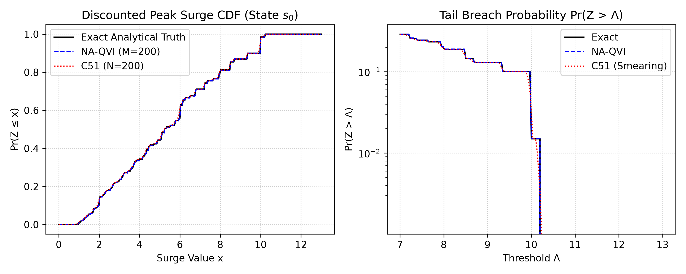

# A Note on Distributional Policy Evaluation for Non-Additive Returns

**Laya Ghodrati**[^corr]

[^corr]: Correspondence to: `laya71@gmail.com`

> **Disclaimer.** The central observation is the author's; the manuscript text, proofs, code, and literature review were generated with AI models and have not been fully independently verified.


---

## Abstract

In Markov decision processes with non-additive performance criteria—such as peak surges ($\max_t \gamma^t R_t$) or capacity-bounded payouts ($\min(C, r + \gamma z)$)—standard expected-value dynamic programming fails on the original state space because expectation does not commute with non-linear aggregators ($\mathbb{E}[\max(X, Y)] \ne \max(\mathbb{E}[X], \mathbb{E}[Y])$). Recent frameworks for non-cumulative reinforcement learning address this by augmenting the state space with running historical statistics. In this note, we observe that for policy evaluation, this non-commutativity barrier does not arise in distributional reinforcement learning, where dynamic programming operates directly on the return distribution via random variable push-forwards ($Z \stackrel{D}{:=} W(R, Z')$). For contractive aggregators $W$ that are uniformly $\kappa$-Lipschitz in the second argument ($\kappa < 1$), contraction of the Bellman operator in the Wasserstein metric is a direct consequence of classical results on iterated random functions (Diaconis & Freedman, 1999). When $W$ is comonotonic, one-dimensional quantiles push forward point-wise without single-step projection error. However, environmental mixtures across stochastic transitions still require quantile projection ($\Pi_M^{W_1}$); we prove that naively averaging quantiles across successors collapses the representation to a degenerate scalar fixed point. We provide a tabular quantile value iteration algorithm (NA-QVI) with an $\mathcal{O}(BM \log B)$ multi-way merge and evaluate it on a recurrent benchmark against an exact analytical ground truth.

---

## 1. Introduction

Value-based reinforcement learning evaluates stationary policies by modeling cumulative returns. In standard Markov Decision Processes (MDPs), the state-action value function evaluates expected geometrically discounted sums:

```math
Q^\pi(s, a) = \mathbb{E} \left[ \sum_{t=0}^\infty \gamma^t R_t \;\middle\vert{}\; S_0 = s, A_0 = a \right]. \tag{1}
```

Distributional Reinforcement Learning (DRL) (Bellemare et al., 2017) instead tracks the full return distribution $Z^\pi(s, a)$, where $\mathbb{E}[Z^\pi(s, a)] = Q^\pi(s, a)$. The standard distributional Bellman equation relies on an affine relation:

```math
T_{R, \gamma}(x) = R + \gamma x \implies Z(s, a) \stackrel{D}{:=} (T_{R, \gamma})_\sharp Z(S', A'). \tag{2}
```

This linear relation does not capture objectives that accumulate non-additively:

* **Peak and Extremal Criteria:** Systems evaluated on transient peak surges ($\sup_t \gamma^t R_t$) or bottleneck throughput rather than cumulative load.
* **Bounded Buffers and Payout Caps:** Payouts subject to saturation thresholds $C$, evolving as $x \mapsto \min(C, R + \gamma x)$.
* **Downside Protections:** Balance sheets protected by zero floors: $x \mapsto \max(0, R + \gamma x)$.

### 1.1 Non-Commutativity in Scalar RL vs. Distributional Evaluation

In scalar RL, non-additive aggregators break the dynamic programming recursion on the base state space $\mathcal{S}$ because expectation does not commute with non-linear functions:

```math
\mathbb{E}[\max(R, \gamma G)] \ne \max(R, \, \gamma \mathbb{E}[G]). \tag{3}
```

To address this, recent works on max-reward and non-cumulative MDPs (Veviurko et al., 2024; Nägele et al., 2024) rely on *state augmentation*. They expand the state space to $\mathcal{S} \times \mathbb{R}$ to track the running historical maximum $h_t = \max_{k < t} \gamma^k R_k$ as an auxiliary state variable. While necessary for history-dependent decision-making, state augmentation introduces continuous state dimensions even when evaluating a fixed policy.

In the distributional setting, this non-commutativity barrier does not apply to policy evaluation. Because the distributional Bellman equation operates at the level of random variables:

```math
Z(s, a) \stackrel{D}{:=} W\big(R(s, a, S'), \, Z(S', A')\big), \tag{4}
```

the law of the return under a fixed stationary policy $\pi$ can be evaluated directly on the base state space $\mathcal{S}$ without augmenting the state with historical statistics.

> **Remark 1 (Evaluation vs. Control).** In optimal control for peak objectives, the optimal action at step $t$ depends on the historical peak observed so far ($h_t$). Thus, state augmentation remains structurally necessary for history-dependent optimal policies. However, for **policy evaluation** (computing the forward-looking return law of a fixed policy), state augmentation is an artifact of scalar expectations that the distributional formulation avoids.

### 1.2 Contributions

1. **Wasserstein Contraction:** We note that the policy evaluation operator $\mathcal{T}_W^\pi$ is a strict $\kappa$-contraction in the maximal $p$-Wasserstein metric $\bar{d}_p$ ($p \in [1, \infty]$) on bounded measures as a direct consequence of contractive iterated random functions (Diaconis & Freedman, 1999).
2. **Quantile Dynamic Programming:** Applying 1D comonotonic quantile equivariance (Embrechts & Hofert, 2013), temporal push-forwards through $W$ operate point-wise, and composing with the 1-Wasserstein quantile projection $\Pi_M^{W_1}$ yields a $\kappa$-contraction in $\bar{d}_\infty$ via Lemma 2 of (Dabney et al., 2018).
3. **Barycentric Variance Collapse:** We provide an elementary proof that coordinate-wise quantile averaging across successors reduces to an uncoupled scalar contraction, demonstrating why the pooled $\Pi_M^{W_1}$ projection is mandatory.
4. **Numerical Validation:** We evaluate tabular quantile value iteration against an exact analytical ground truth on a 3-state recurrent MRP, illustrating proxy mismatch and categorical smearing.

---

## 2. The Non-Additive Distributional Bellman Equation

Let $(\mathcal{S}, \mathcal{A}, P, R, \gamma)$ denote an MDP with discrete state space $\mathcal{S}$ and action space $\mathcal{A}$. For a stationary policy $\pi$, transition probabilities are denoted $P^\pi(s', a' \mid s, a) = P(s' \mid s, a)\pi(a' \mid s')$. Rewards $R(s, a, s')$ have support bounded in $[-R_{\max}, R_{\max}]$ with $R_{\max} < \infty$.

### 2.1 The Contractive Monotone Aggregator

Following the classical conditions for generalized dynamic programming (Denardo, 1967; Sobel, 1975):

> **Definition 1 (Contractive Monotone Aggregator).** A measurable function $W: \mathbb{R} \times \mathbb{R} \to \mathbb{R}$ is a Contractive Monotone Aggregator if:
> 1. **Comonotonicity:** For all $r \in \mathbb{R}$, $z \mapsto W(r, z)$ is non-decreasing: $z_1 \le z_2 \implies W(r, z_1) \le W(r, z_2)$.
> 2. **Uniform Lipschitz Contraction:** There exists $\kappa \in [0, 1)$ such that for all $r, z_1, z_2 \in \mathbb{R}$:
>
> ```math
> \vert{}W(r, z_1) - W(r, z_2)\vert{} \le \kappa \vert{}z_1 - z_2\vert{}. \tag{5}
> ```
>
> 3. **Bounded Baseline:** $W(0, 0) = 0$ and $\sup_{r \in [-R_{\max}, R_{\max}]} \vert{}W(r, 0)\vert{} \le R_{\max}$.

> **Remark 2 (Recursive Structure).** $W$ models per-transition recursive aggregation (e.g., $W(r, z) = \max(r, \gamma z)$). It does not model a terminal utility function applied to an infinite sum, such as $\min(C, \sum_{t=0}^\infty \gamma^t R_t)$, which is non-recursive.

### 2.2 Metric Space Completeness

Under bounded rewards and $\kappa < 1$, any invariant distribution $Z$ satisfying $Z \stackrel{D}{=} W(R, Z)$ has support contained in the compact interval:

```math
\mathcal{D} = \left[ -\frac{R_{\max}}{1 - \kappa}, \; \frac{R_{\max}}{1 - \kappa} \right]. \tag{6}
```

Let $\mathcal{P}(\mathcal{D})$ denote probability measures supported on $\mathcal{D}$. For $p \in [1, \infty)$, the $p$-Wasserstein metric is:

```math
d_p(\mu, \nu) = \left( \int_0^1 \big\vert{} F_\mu^{-1}(u) - F_\nu^{-1}(u) \big\vert{}^p \, du \right)^{1/p}, \tag{7}
```

and for $p = \infty$:

```math
d_\infty(\mu, \nu) = \sup_{u \in (0, 1)} \big\vert{} F_\mu^{-1}(u) - F_\nu^{-1}(u) \big\vert{}. \tag{8}
```

Because $\mathcal{D}$ is compact, $d_\infty(\mu, \nu) \le \frac{2 R_{\max}}{1 - \kappa} < \infty$. The space $(\mathcal{P}(\mathcal{D}), d_p)$ is a complete metric space for all $p \in [1, \infty]$ (Villani, 2009, Theorem 6.18). We endow the collection space $\mathcal{M} = \mathcal{P}(\mathcal{D})^{\vert \mathcal{S} \vert \times \vert \mathcal{A} \vert}$ with the maximal metric $\bar{d}_p(Z_1, Z_2) = \max_{s, a} d_p(Z_1(s, a), Z_2(s, a))$.

### 2.3 The Evaluation Operator and Contraction

> **Definition 2.** The policy evaluation operator $\mathcal{T}_W^\pi: \mathcal{M} \to \mathcal{M}$ is defined by:
>
> ```math
> (\mathcal{T}_W^\pi Z)(s, a) \stackrel{D}{:=} W\big(R(s, a, S'), \, Z(S', A')\big), \tag{9}
> ```
>
> where $S' \sim P(\cdot \mid s, a)$, $A' \sim \pi(\cdot \mid S')$, and $Z(S', A')$ is conditionally independent of $R(s, a, S')$ given $(S', A')$.

> **Theorem 1 (Wasserstein Contraction).** Let $W$ be a Contractive Monotone Aggregator with modulus $\kappa \in [0, 1)$. Then for any $p \in [1, \infty]$, $\mathcal{T}_W^\pi$ is a strict $\kappa$-contraction on $(\mathcal{M}, \bar{d}_p)$:
>
> ```math
> \bar{d}_p(\mathcal{T}_W^\pi Z_1, \, \mathcal{T}_W^\pi Z_2) \le \kappa \, \bar{d}_p(Z_1, Z_2), \tag{10}
> ```
>
> and possesses a unique fixed point $Z^{\ast, \pi} \in \mathcal{M}$.

*Proof.* Fix $(s, a)$. Let $(S', A') \sim P^\pi(\cdot \mid s, a)$, $R = R(s, a, S')$, and let $\rho_{S', A'}$ denote the optimal Wasserstein coupling achieving $d_p(Z_1(S', A'), Z_2(S', A'))$. Construct a coupling for $\mathcal{T}_W^\pi Z_1(s, a)$ and $\mathcal{T}_W^\pi Z_2(s, a)$ by passing $(U, V) \sim \rho_{S', A'}$ through $W$ under realization $R$: $X = W(R, U)$, $Y = W(R, V)$. By definition of $d_p$:

```math
\begin{aligned} d_p^p\Big( (\mathcal{T}_W^\pi Z_1)(s, a), \, (\mathcal{T}_W^\pi Z_2)(s, a) \Big) &\le \mathbb{E}_{R, S', A'} \Big[ \mathbb{E}_{(U, V) \sim \rho_{S', A'}} \big[ \vert{}X - Y\vert{}^p \big] \Big] \\ &\le \kappa^p \, \mathbb{E}_{S', A'} \Big[ d_p^p\big( Z_1(S', A'), Z_2(S', A') \big) \Big] \le \kappa^p \, \bar{d}_p^p(Z_1, Z_2). \end{aligned} \tag{11}
```

Taking the $p$-th root and maximum over $(s, a)$ yields the bound. For $p = \infty$, the essential supremum yields $\vert{}X - Y\vert{} \le \kappa \vert{}U - V\vert{} \le \kappa \bar{d}_\infty(Z_1, Z_2)$ almost surely. $\blacksquare$

> **Remark 3 (Connection to Iterated Random Functions).** This contraction argument is standard in the theory of iterated random functions (Diaconis & Freedman, 1999). It requires only the Lipschitz condition $\vert{}W(r, z_1) - W(r, z_2)\vert{} \le \kappa \vert{}z_1 - z_2\vert{}$. Comonotonicity is not needed for Theorem 1; its role is in quantile propagation below.

---

## 3. Quantile Dynamic Programming

### 3.1 Single-Branch Equivariance vs. Transition Mixtures

For any random variable $X$ with quantile function $F_X^{-1}$ and any non-decreasing, continuous function $T$, the quantile function satisfies (Embrechts & Hofert, 2013):

```math
F_{T(X)}^{-1}(\tau) = T\big( F_X^{-1}(\tau) \big) \quad \text{for all } \tau \in (0, 1). \tag{12}
```

For a single deterministic transition branch $(s, a) \to (r, s', a')$, quantiles propagate point-wise:

```math
q_\tau \leftarrow W\big(r, \, q_\tau(s', a')\big). \tag{13}
```

However, when transitions or rewards are stochastic, the target distribution is a mixture $\mu = \sum_k w_k \mu_k$. Quantile functions do not commute with convex combinations: $F_\mu^{-1}(\tau) \ne \sum_k w_k F_{\mu_k}^{-1}(\tau)$. Averaging quantiles across successors computes the 1D Wasserstein barycenter, which collapses distribution variance (Section 3.3).

To project the mixture back into an $M$-quantile representation, we use the 1-Wasserstein quantile projection $\Pi_M^{W_1}$ (Bellemare et al., 2023, Chapter 5), which evaluates the generalized inverse mixture CDF at midpoints $\tau_m = \frac{2m - 1}{2M}$:

```math
\theta_m = F_\nu^{-1}(\tau_m), \quad m \in \lbrace 1, \dots, M\rbrace. \tag{14}
```

### 3.2 Contraction of the Projected Operator

> **Theorem 2.** The projection $\Pi_M^{W_1}$ is a non-expansion in $d_\infty$: $d_\infty(\Pi_M^{W_1} \mu, \Pi_M^{W_1} \nu) \le d_\infty(\mu, \nu)$ (Dabney et al., 2018, Lemma 2 in proof of Proposition 2). Consequently:
> 1. $\Pi_M^{W_1} \mathcal{T}_W^\pi$ is a strict $\kappa$-contraction in $\bar{d}_\infty$:
>
> ```math
> \bar{d}_\infty(\Pi_M^{W_1} \mathcal{T}_W^\pi Z_1, \, \Pi_M^{W_1} \mathcal{T}_W^\pi Z_2) \le \kappa \, \bar{d}_\infty(Z_1, Z_2). \tag{15}
> ```
>
> 2. There exists a unique projected fixed point $Z_\theta^{\ast, \pi}$.
> 3. The error relative to the true distribution $Z^{\ast, \pi}$ satisfies:
>
> ```math
> \bar{d}_\infty(Z_\theta^{\ast, \pi}, Z^{\ast, \pi}) \le \frac{1}{1 - \kappa} \, \bar{d}_\infty(\Pi_M^{W_1} Z^{\ast, \pi}, \, Z^{\ast, \pi}). \tag{16}
> ```

The proof follows directly from the non-expansion of $\Pi_M^{W_1}$, Theorem 1 at $p = \infty$, and Banach's Fixed-Point Theorem.

### 3.3 Barycentric Variance Collapse

The following proposition explains why explicit mixture projection is necessary:

> **Proposition 1 (Barycentric Variance Collapse).** Let $T_{\text{bary}}$ denote the update that averages quantiles across successors:
>
> ```math
> \theta_m^{(n+1)}(s) = \sum_{s'} P(s' \mid s) \sum_k p_k \, W\big(r_k, \, \theta_m^{(n)}(s')\big), \tag{17}
> ```
>
> where $k \in \lbrace 1, \dots, K\rbrace$ indexes reward outcomes and $n$ indexes iteration. Then for every atom index $m \in \lbrace 1, \dots, M\rbrace$, the vector $\mathbf{v}_m^{(n)} = [\theta_m^{(n)}(s_1), \dots, \theta_m^{(n)}(s_{\vert \mathcal{S} \vert})]^T$ evolves under the same scalar contraction $F: \mathbb{R}^{\vert \mathcal{S} \vert} \to \mathbb{R}^{\vert \mathcal{S} \vert}$:
>
> ```math
> [F(\mathbf{v})](s) = \sum_{s'} P(s' \mid s) \sum_k p_k \, W\big(r_k, \, \mathbf{v}(s')\big), \tag{18}
> ```
>
> which is a $\kappa$-contraction in $\Vert{}\cdot\Vert{}_\infty$. For any initialization, all $M$ atom vectors converge to the identical scalar vector $\mathbf{v}^{\ast}$:
>
> ```math
> \lim_{n \to \infty} \theta_m^{(n)}(s) = v^{\ast}(s) \quad \text{for all } m \in \lbrace 1, \dots, M\rbrace, \tag{19}
> ```
>
> collapsing the representation to a single point mass.

*Proof.* Coordinate $m$ does not interact with any other coordinate $j \ne m$. For $\mathbf{u}, \mathbf{v} \in \mathbb{R}^{\vert \mathcal{S} \vert}$, the Lipschitz property yields $\vert{}[F(\mathbf{u})](s) - [F(\mathbf{v})](s)\vert{} \le \kappa \Vert{}\mathbf{u} - \mathbf{v}\Vert{}_\infty$. By Banach's theorem, $F$ has a unique fixed point $\mathbf{v}^{\ast}$. Because the recurrence $\mathbf{v}_m^{(n+1)} = F(\mathbf{v}_m^{(n)})$ is identical for all $m$, $\mathbf{v}_m^{(n)} \to \mathbf{v}^{\ast}$ as $n \to \infty$. $\blacksquare$

### 3.4 Algorithm: Non-Additive Quantile Value Iteration (NA-QVI)

Let $B = \vert \mathcal{S}' \vert \vert \mathcal{A}' \vert K$ be the number of discrete transition branches. Because each incoming vector $\boldsymbol{\theta}(s', a')$ is pre-sorted and $z \mapsto W(r_k, z)$ is non-decreasing, each branch produces an already-sorted stream $[W(r_k, \theta_1), \dots, W(r_k, \theta_M)]$. Using a $B$-way min-heap merge, the pooled CDF is constructed in $\mathcal{O}(BM \log B)$ rather than a full $\mathcal{O}(BM \log(BM))$ sort. In sample-based settings, stochastic approximation converges under quantile temporal-difference learning (Rowland et al., 2024).

---

## 4. Numerical Evaluation

### 4.1 Benchmark Setup

We evaluate a 3-state recurrent Markov Reward Process ($\mathcal{S} = \lbrace s_0, s_1, s_2\rbrace$, $\vert \mathcal{A} \vert = 1$):

```math
P = \begin{pmatrix} 0.5 & 0.3 & 0.2 \\ 0.4 & 0.4 & 0.2 \\ 0.2 & 0.3 & 0.5 \end{pmatrix}. \tag{20}
```

Transitions emit bimodal rewards (background load with probability $1 - p_{\text{spike}}$, surge with probability $p_{\text{spike}}$):
$(s_0, s_0)$: $1.0$ ($0.8$), $6.0$ ($0.2$);
$(s_0, s_1)$: $2.0$ ($0.7$), $10.0$ ($0.3$);
$(s_0, s_2)$: $0.5$ ($0.9$), $8.0$ ($0.1$);
$(s_1, s_0)$: $1.5$ ($0.85$), $7.0$ ($0.15$);
$(s_1, s_1)$: $1.0$ ($0.9$), $5.0$ ($0.1$);
$(s_1, s_2)$: $2.0$ ($0.75$), $12.0$ ($0.25$);
$(s_2, s_0)$: $0.5$ ($0.95$), $4.0$ ($0.05$);
$(s_2, s_1)$: $1.0$ ($0.8$), $9.0$ ($0.2$);
$(s_2, s_2)$: $1.5$ ($0.7$), $11.0$ ($0.3$).
We evaluate the peak surge aggregator $W_{\max}(r, z) = \max(r, 0.85 z)$ on state $s_0$.

### 4.2 Exact Analytical Ground Truth

For the discounted peak process $G = \max_{t=0}^H \gamma^t R_t$, notice that $\max_{t=0}^H \gamma^t R_t \le x \iff R_t \le \gamma^{-t} x$ for all $t$. Defining $[P_t(x)]_{s, s'} = P(s' \mid s) \sum_{k: r_k \le \gamma^{-t} x} p_k$, the exact CDF at horizon $H = 60$ ($R_{\max} \gamma^{60} \le 12 \cdot 0.85^{60} \approx 6.94 \times 10^{-4}$) is computed via backward products:

```math
F_{Z(s_0)}(x) = \mathbf{e}_{s_0}^T \left( \prod_{t=0}^H P_t(x) \right) \mathbf{1}. \tag{21}
```

### 4.3 Results

To examine behavior across different support regions, we test a sweep of thresholds $\Lambda$ categorized by position: *Near-atom* ($\Lambda = 10.0$, immediately adjacent to the 9% atom at 10.0), *Inter-atom* ($\Lambda = 7.0$, situated between discrete probability masses), and *Off-atom* ($\Lambda \in \lbrace 3.5, 5.0, 8.5, 9.5, 10.5\rbrace$, lying in smooth support regions or beyond the support). The results are summarized in Tables 1–3 and illustrated in Figure 1.

**Table 1.** Distributional metrics and quantiles for peak surge $Z(s_0)$. Additive QDP computes the cumulative sum $\sum_t \gamma^t R_t$; reported to illustrate proxy mismatch.

| Metric | Exact Truth | NA-QVI ($M=200$) | C51 ($N=51$) | C51 ($N=200$) | Additive QDP |
| --- | --- | --- | --- | --- | --- |
| $q_{0.10}$ | 1.97 | 2.00 | 1.80 | 1.96 | 10.55 |
| Median ($q_{0.50}$) | 5.22 | 5.22 | 5.40 | 5.28 | 16.89 |
| $q_{0.90}$ | 10.01 | 9.41 | 9.90 | 9.95 | 25.46 |
| $q_{0.99}$ | 10.21 | 10.20 | 10.20 | 10.18 | 33.05 |
| $W_1$ Error vs. Exact | — | **0.0143** | 0.0943 | 0.0314 | n/a (proxy sum) |
| Iterations to Converge | — | 18 | 21 | 21 | 93 |

**Table 2.** SLA breach probability $P(Z(s_0) > \Lambda)$ across threshold sweep.

| Threshold $\Lambda$ | Type | Exact Truth | NA-QVI ($M=200$) | C51 ($N=51$) | C51 ($N=200$) | Additive QDP |
| --- | --- | --- | --- | --- | --- | --- |
| $\Lambda = 3.5$ | Off-atom | 72.12% | 72.00% | 71.74% | 71.68% | 100.0% |
| $\Lambda = 5.0$ | Off-atom | 55.53% | 55.50% | 56.05% | 55.47% | 100.0% |
| $\Lambda = 7.0$ | Inter-atom | 28.88% | 29.00% | 28.56% | 28.88% | 99.50% |
| $\Lambda = 8.5$ | Off-atom | 14.52% | 14.50% | 15.80% | 17.66% | 98.00% |
| $\Lambda = 9.5$ | Off-atom | 10.05% | 10.00% | 10.95% | 10.05% | 94.50% |
| $\Lambda = 10.0$ | Near-atom | 1.50% | 1.50% | 4.35% | 7.20% | 92.50% |
| $\Lambda = 10.5$ | Off-atom | 0.00% | 0.00% | 0.00% | 0.00% | 90.00% |

**Table 3.** NA-QVI discretization error sweep vs. exact ground truth.

| Atom Count $M$ | $W_1$ Error vs. Exact | Iterations | Median ($q_{0.50}$) | $q_{0.99}$ |
| --- | --- | --- | --- | --- |
| $M = 50$ | 0.0181 | 15 | 5.272 | 10.10 |
| $M = 100$ | 0.0232 | 16 | 5.220 | 10.00 |
| $M = 200$ | 0.0143 | 18 | 5.220 | 10.20 |
| $M = 400$ | 0.0099 | 17 | 5.220 | 10.20 |



**Figure 1.** Comparison of return distribution estimates for peak surge $Z(s_0)$. Left: Cumulative distribution function $\Pr(Z \le x)$ across the support. Right: Tail breach probability $\Pr(Z > \Lambda)$ on a logarithmic scale for $\Lambda \ge 7.0$, highlighting categorical smearing near $\Lambda = 10.0$.

### 4.4 Observations

1. **NA-QVI Accuracy and Atom Quantization:** NA-QVI tracks the exact analytical CDF across quantiles ($W_1 = 0.0143$ at $M = 200$). In Table 3, $W_1$ error does not decrease strictly monotonically from $M=50$ to $M=100$. Unlike continuous distributions where quantile approximation error scales smoothly as $\mathcal{O}(1/M)$, discrete distributions exhibit step discontinuities; uniform midpoint grids $\tau_m = \frac{2m-1}{2M}$ can exhibit slight alignment oscillations across finite $M$ depending on whether specific midpoints fall immediately before or after a jump.
2. **Additive Model Mismatch:** An additive discounted sum accumulates background transitions over time ($q_{0.50} = 16.89$ vs. true peak $5.22$), predicting a $99.50\%$ breach probability at $\Lambda = 7.0$ where the true system breaches only $28.88\%$ of the time.
3. **Categorical Grid Smearing:** At $\Lambda = 10.0$, the true breach probability is $1.50\%$ (governed by entering $s_1$ at $t=0$ and realizing $R(s_1, s_2)=12.0$ at $t=1$: $0.3 \times 0.2 \times 0.25 = 0.015$). However, C51 ($N=51$) reports $4.35\%$ and C51 ($N=200$) reports $7.20\%$. This inflation is caused by the 9% probability atom at exactly $r = 10.0$ ($P(s_0 \to s_1) \cdot P(R=10) = 0.3 \times 0.3 = 0.09$). For $N=51$ on $[0, 15]$ (grid spacing $\Delta z = 0.3$), $10.0$ is not a grid node ($10.0 / 0.3 = 33.33$). Categorical projection splits this 9% mass between node $33$ ($9.9$) and node $34$ ($10.2$), pushing $(10.0 - 9.9)/0.3 = 1/3$ of the mass ($3.0\%$) onto node $34 > 10.0$. Adding this smeared mass to the true $1.50\%$ yields $4.35\%$.
4. **Barycentric Collapse:** The naive barycentric update converges to $\mathbf{v}^{\ast} = [5.2209, 5.0038, 5.8339]^T$ across all atoms ($W_1 = 2.259$), confirming Proposition 1.

---

## 5. Conclusion and Limitations

Contractive non-additive dynamic programming extends directly to the distributional setting for policy evaluation, avoiding the expectation non-commutativity that requires state augmentation in scalar approaches.

**Limitations:** This observation applies strictly to **policy evaluation**. In the control setting, selecting actions greedily via risk metrics (e.g., $\arg\min_a \text{VaR}_\alpha(Z(s, a))$) breaks the Wasserstein non-expansion (Bellemare et al., 2017). Furthermore, optimal policies for non-additive criteria are inherently history-dependent, meaning optimal control still requires historical state tracking. Extending stable policy iteration to non-additive quantiles remains an open problem.

---

## References

* Bellemare, M. G., Dabney, W., & Munos, R. (2017). A distributional perspective on reinforcement learning. In *International Conference on Machine Learning (ICML)*, pp. 449–458.
* Bellemare, M. G., Dabney, W., & Rowland, M. (2023). *Distributional Reinforcement Learning*. MIT Press.
* Dabney, W., Rowland, M., Bellemare, M. G., & Munos, R. (2018). Distributional reinforcement learning with quantile regression. In *AAAI Conference on Artificial Intelligence*, Vol. 32.
* Denardo, E. V. (1967). Contraction mappings in the theory underlying dynamic programming. *SIAM Review*, 9(2), 165–177.
* Diaconis, P., & Freedman, D. (1999). Iterated random functions. *SIAM Review*, 41(1), 45–76.
* Embrechts, P., & Hofert, M. (2013). A note on generalized inverses. *Mathematical Methods of Operations Research*, 77(3), 423–432.
* Nägele, M., Olle, J., Fösel, T., Zen, R., & Marquardt, F. (2024). Tackling decision processes with non-cumulative objectives using reinforcement learning. *arXiv preprint arXiv:2405.13609*.
* Rowland, M., Munos, R., Azar, M. G., Tang, Y., Ostrovski, G., Harutyunyan, A., Tuyls, K., Bellemare, M. G., & Dabney, W. (2024). An analysis of quantile temporal-difference learning. *Journal of Machine Learning Research*, 25(163), 1–47.
* Sobel, M. J. (1975). Ordinal dynamic programming. *Management Science*, 21(9), 967–975.
* Veviurko, G., Böhmer, W., & de Weerdt, M. (2024). To the max: Reinventing reward in reinforcement learning. In *International Conference on Machine Learning (ICML)*.
* Villani, C. (2009). *Optimal Transport: Old and New*. Grundlehren der mathematischen Wissenschaften, Vol. 338. Springer-Verlag.
